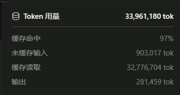

# Endfield-Gacha

# 终末地抽卡模拟器

本项目相当之简陋（真的）

原本是手搓的，后来改bug改疯了（真）
所以找DeepSeek 改的代码（怒烧3千4百万token，我无疑是难绷的）



## 功能

1、模拟《明日方舟：终末地》的角色招募（1.0~1.6 卡池 + 常驻池）
2、《明日方舟：终末地》全角色立绘
3、出率统计、保底计数、资源换算（嵌晶玉／衍质源石／武库配额）、寻访道具统计


## 两个版本

### 图形界面版 EndfieldGachaGUI.exe（推荐）

- **① 选择卡池**：按版本（1.0~1.6／常驻池）选择卡池，实时显示卡池时间、UP角色、6星池与5星池
- **② 保底与次数**：填写剩余大保底（0~120，0=本期角色井已消耗）、小保底（1~80）、5星保底（1~10）与寻访次数
- **③ 操作**：寻访1次／寻访10次／按次数寻访（最多10000）
- **④ 当前状态**：剩余各保底、本池与累计寻访次数、各星级出率、嵌晶玉／衍质源石、武库配额与申领次数、**寻访情报书**与**流光庆时调用凭证**数量
- **寻访结果**：按星级着色（6星橙／5星金／4星紫／提示蓝）逐条显示，最多保留最近2000行
- **声明与规则**：软件声明 + 抽卡规则摘要
- **仓库统计**：每位干员的获取次数与出率、综合出率、资源与道具合计
- **角色图鉴**：34名干员列表（按星级着色）+ **窗口内立绘预览**，可调用系统看图或打开 fz.wiki 页面
- **注意**：此版本*编译*依赖于下方**控制台版**！！！

### 控制台版 EndfieldGacha.exe

原来的终端版本，功能与图形界面版完全一致（共用同一套抽卡内核）。


## 抽卡规则（已按游戏实际机制实现）

| 项目 | 规则 |
| --- | --- |
| 基础出率 | 6星 0.8%（其中UP占50%）、5星 8%、4星 91.2% |
| 6星保底 | 80抽必得；距上次6星满66抽起每抽+5%（第66抽5.8%，第79抽70.8%） |
| 5星保底 | 10抽内必得5星及以上，出5星或6星均清空计数（跨池继承） |
| 角色井 | 特许／重构寻访单池120抽内必得当期UP，获得后即消耗，不跨池继承 |
| 信物赠礼 | 每累计寻访240次获得当期UP干员信物×1 |
| 寻访里程碑 | 特许寻访30抽送加急十连、60抽送寻访情报书；重构寻访30/60/90抽各送加急十连 |
| 特殊寻访 | 「辉光庆典」6星池仅4名UP角色且保底独立；60抽基础寻访凭证、120抽自选调用凭证 |
| 武库配额 | 每获得1名干员得6星2000／5星200／4星20；1980配额可申领10把武器 |
| 货币 | 1抽=500嵌晶玉，1衍质源石=75嵌晶玉 |

> 注：加急招募（免费十连）结果不计入保底计数与累计寻访次数，十连内必得5星及以上。


## 如果你懒得上GitHub更新（真）……

按下面 **6 个步骤**改，漏掉任何一处都会出 bug（当然不是啥子陈千语作者更新掉坑写的）（文末有"常见坑对照表"）

### 第 1 步：写入卡池数据 —— `codes/EndfieldGacha.cpp` 的 `SetSection`

复制一份现成卡池块，改 `section` 序号与角色名：

```cpp
    //1.6上半
    if(section == 14)
    {
        stars6.push_back("祀");          // 第1个必须是当期UP角色
        stars6.push_back("提弗洛斯");     // 之后是6星池里的非UP角色
        stars6.push_back("梨诺");
        stars6.push_back("艾尔黛拉");
        stars6.push_back("余烬");
        stars6.push_back("黎风");
        stars6.push_back("别礼");
        stars6.push_back("骏卫");
        stars6_count = 8;                // 必须等于上面 push_back 的条数
        up_stars6_count = 1;             // UP角色个数（辉光庆典那种4UP写4）
        stars5.push_back("阿列什");
        // ……5星照抄
        stars5_count = 9;
        stars4.push_back("安塔尔");
        // ……4星照抄
        stars4_count = 5;                // ★千万别漏，漏了抽到4星会除以零闪退
    }
```

要点：
- `stars6_count` / `stars5_count` / `stars4_count` 必须与实际 `push_back` 的条数一致
- `up_stars6_count` = 前几个是UP角色（普通池写 0）
- 卡池类型：默认 `banner_type = 1`（特许寻访）；重构寻访加一行 `banner_type = 3;`（30/60/90抽送加急十连）；特殊寻访写 `banner_type = 2;`（6星池全UP + 60/120抽里程碑）
- 6星池按游戏的"下架后保留3期"规则排：**当期UP + 前3期内仍在池的UP角色 + 5名常驻**（艾尔黛拉/余烬/黎风/别礼/骏卫）

### 第 2 步：加卡池菜单文字 —— 同文件 `AskSection`

```cpp
        //1.6版本
        if(version == 7)
        {
            cout <<"1.6上半  万物更新       祀      2026.10.15~2026.11.5  14\n";
            cout <<"1.6下半  祖泉的新流     汤汤    2026.10.29~2026.11.19 15\n";
        }
```

并在同一函数的合法校验里加上新 section（**漏了会"能显示菜单但选序号报错"**）：

```cpp
        else if(version == 7 && (section == 14 || section == 15))
            valid = true;
```

### 第 3 步：加版本行 + 改版本范围 —— 同文件 `AskVersion`

```cpp
        cout <<"1.6  丹青渡         2026.10.15~2026.11.19 7\n";
        ...
        if (version >= 1 && version <= 7)   // ★每加一个版本，这里上限+1，否则选新版本会提示输入有误
```

### 第 4 步：登记新角色 —— 4 个数组 + 图鉴循环次数

```cpp
ALL_STARS6      // 6星名单（仓库统计、武库配额靠它）
ALL_CHARACTERS  // 图鉴名单（顺序必须是：6星 → 5星 → 4星）
ENGLISH         // 立绘文件名（如 Typhoeus.jpg 的 Typhoeus）；没有图就填 "none"
WEBSIDES        // fz.wiki 介绍链接；没有就填 "none"
```

- **四个数组长度必须相同**，且 `ENGLISH[i]`、`WEBSIDES[i]` 要和 `ALL_CHARACTERS[i]` 处在**同一位置**
- 最容易错的地方：把新角色塞在 6 星块的末尾（或中间），却没在 `WEBSIDES` 的**同一位置**插入，会让后面所有角色的介绍链接整体错位（V1.6 就踩过这个坑）
- 图鉴的循环次数也要同步（三处数字：6星人数 / 6星+5星人数 / 总人数）：

```cpp
        for (int i = 0; i < 19; i++)     // 6星：含管理员-男/女（当前19人）
        for (int i = 19; i < 29; i++)    // 5星（当前10人）
        for (int i = 29; i < 34; i++)    // 4星（当前5人，总34人）
```

### 第 5 步：图形界面版 —— `codes/EndfieldGachaGUI.cpp` 的 `BANNERS` 表

按「版本号, section, 版本名, 卡池名, UP角色, 时间」加行：

```cpp
    {7,  14, L"1.6 丹青渡",  L"万物更新",   L"祀",   L"2026.10.15~2026.11.5"},
    {7,  15, L"1.6 丹青渡",  L"祖泉的新流", L"汤汤", L"2026.10.29~2026.11.19"},
```

- 第 1 列版本号要和内核的 `version` 一致（1、2、3……）
- **常驻池固定用版本号 8**（`{8, 999, …}`），否则它会和最新版本混在一起
- 版本下拉的循环上限要同步：`for (int i = 1; i <= 8; i++)`（最后一项是常驻池）
- 顺手改窗口标题和主菜单里的版本号

### 第 6 步：编译 + 自检

1. 双击 `build.bat`（脚本里已用 `codes\` 路径，编译产物输出到根目录）
2. 控制台版自检：
   - 选新版本 → 能进新卡池（不提示"输入有误"）
   - 抽 30 次 → 4/5/6 星都有、**不闪退**（闪退=`stars4_count` 之类的计数漏写）
   - 抽满 120 抽出 UP（角色井）；重构寻访在 30 抽送一次加急十连
   - 菜单 4「角色图鉴」→ 条目数=角色总数，序号、角色名、链接一一对应
3. 图形界面版自检：版本下拉能看到新版本、卡池下拉里**只有该版本**的卡池、抽卡与状态栏正常

### 常见坑对照表

| 现象 | 原因 |
| --- | --- |
| 选新版本后提示"输入有误" | `AskVersion` 里的 `version <= N` 上限没改 |
| 卡池菜单能显示，但选序号报错 | `AskSection` 的 `valid` 校验没加新 section |
| **抽到4星直接闪退** | `SetSection` 里漏写 `stars4_count = 5;`（`getRand(1,0)` 除以零） |
| 图形界面看不到常驻池 / 常驻池混进新版本 | 常驻池版本号没改成 8，或版本下拉循环上限没改 |
| 图鉴里某角色的链接是别人的 | `WEBSIDES` 的插入位置和 `ALL_CHARACTERS` 不对齐 |
| 图鉴少了最后几个角色 | 图鉴三处循环次数没跟着角色总数改 |
| 抽到新角色但仓库里没有 | 没加进 `ALL_STARS6` |
| 5星池人数不对 / 抽卡报错 | `stars5_count` 与实际 `push_back` 条数不符 |


## 开发

使用C++，两个cpp文件；图形界面基于 Win32 API + GDI+，无第三方依赖，用 MinGW-w64 g++ 编译。

- `codes/EndfieldGacha.cpp`：抽卡内核（卡池数据、保底逻辑、批量寻访接口 `DoBatchPull`）+ 控制台界面
- `codes/EndfieldGachaGUI.cpp`：复用上面的内核，实现 Win32 图形界面
- 立绘放在 `CharacterImages/` 下，文件名与内核中的英文名一致（如 提弗洛斯 → `Typhoeus.jpg`）
- 图片路径以 **exe 所在目录** 为基准拼接，因此双击运行或从其他目录启动都能正常打开立绘

### 编译

双击 `build.bat` 一键编译两个版本（脚本内提示信息为英文，避免 cmd 的编码问题），或手动执行：

```
g++ -O2 -std=gnu++17 -finput-charset=UTF-8 -o EndfieldGacha.exe codes\EndfieldGacha.cpp -static -lshell32
g++ -O2 -std=gnu++17 -finput-charset=UTF-8 -mwindows -o EndfieldGachaGUI.exe codes\EndfieldGachaGUI.cpp -static -lgdiplus -lshell32 -lgdi32 -luser32
```


## 未来更新预期

    添加存档功能

# 声明
卡池信息、角色信息及立绘来源自公开Wiki https://www.fz.wiki/

爱写作业的好汉 2026.10.17
